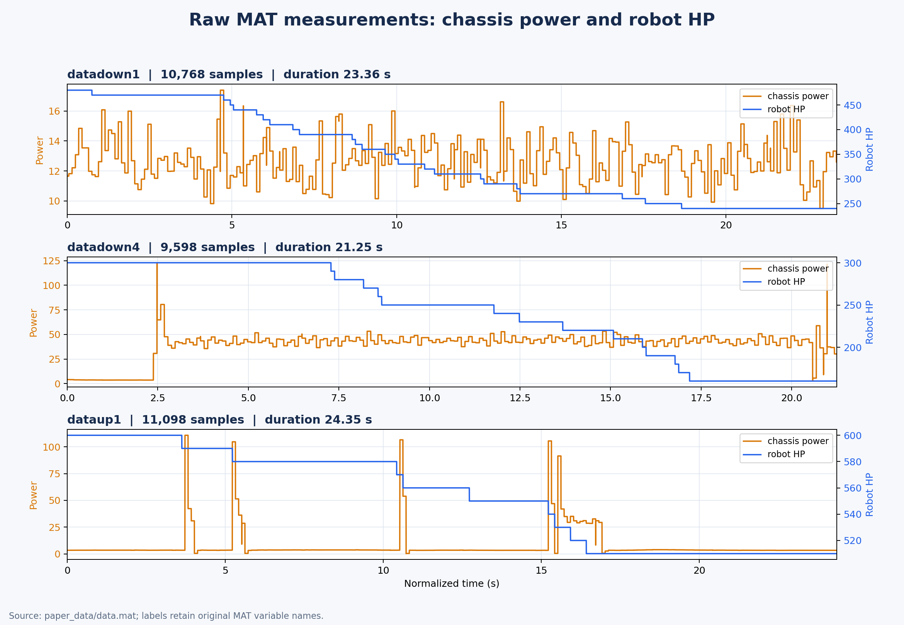

# Infantry_Gyroscope

基于 RoboMaster 步兵机器人底盘的控制工程，重点实现两类相对独立的运动模式：

- **小陀螺模式**：底盘持续自转，云台独立稳向，用于移动、观察和持续防御。
- **冲击摆动模式**：检测到装甲受击后，底盘短时旋转约 30°，改变受击面，同时保持云台朝向和底盘平移方向。

项目的控制思想：基于姿态解算使底盘不跟随云台；麦克纳姆轮负责全向运动和躲避弹丸，导电滑环实现底盘与云台的电源、信号解耦，云台负责保持视野和运动朝向。

## 1. 系统架构


图源：论文图 2。系统由五层组成：

- **硬件层**：四轮麦克纳姆底盘、Yaw/Pitch 云台、导电滑环和装甲/射击机构。
- **硬件配置层**：`standard_robot.ioc` 配置 STM32F407 的 CAN、UART、SPI、I2C、定时器、DMA、USB 和 FreeRTOS。
- **驱动层**：STM32 HAL、CMSIS、BSP 和 BMI088/IST8310 等传感器驱动。
- **控制层**：PID、AHRS、麦轮运动学、CAN 电机通信和功率控制。
- **任务层**：底盘、云台、IMU、裁判系统、射击和故障检测任务。

底盘和云台通过滑环实现电源与信号解耦，底盘负责运动和防御，云台负责稳向、观察和反击。

### 1.1 坐标系与控制闭环


图源：论文图 3。底盘坐标系以前进方向为 X 轴、左移方向为 Y 轴，云台与底盘的相对角为 `theta`。

核心闭环为：

```text
遥控器/裁判数据 -> 坐标变换 -> 麦轮速度解算
                 -> 电机 PID/CAN -> 姿态与电机反馈
```

## 2. 小陀螺模式

小陀螺模式的本质是：**底盘持续提供角速度 `omega`，云台通过独立的 Yaw/Pitch 闭环保持自己的目标角度**。因此底盘可以自转或边移动边自转，而云台仍能保持观察方向。

论文测试中使用过 `3 rad/s` 和 `7 rad/s` 两种自转速度。该模式连续、响应直接，但机器人位置大致不变，装甲可能周期性回到原受击位置；持续攻击时，功耗和重复受击风险会增加。

### 小陀螺演示

视频展示底盘持续旋转时云台保持独立朝向：

<video controls width="720" preload="metadata">
  <source src="./paper_data/小陀螺v8.mp4" type="video/mp4">
  当前查看器不支持直接播放，请<a href="./paper_data/小陀螺v8.mp4">打开小陀螺v8.mp4</a>。
</video>

[打开或下载：小陀螺v8.mp4](./paper_data/小陀螺v8.mp4)

## 3. 防御策略优化：冲击摆动


图源：论文图 4。冲击摆动不是持续高速旋转，而是由受击事件触发的有限角度姿态调整：

1. 读取云台 Yaw 与底盘的相对角 `theta`，完成 X/Y 速度坐标变换。
2. 轮询裁判系统伤害数据，判断是否发生弹丸打击或装甲受伤。
3. 受击时将目标旋转角增加约 `30°`，再进行角度限幅和 Z 轴 PID 控制。
4. 未受击时保持目标角度不变，即 `omega = 0`；受击时只短时改变底盘姿态。
5. 对 X/Y 平移速度进行限幅并解算四个麦轮速度，保证防御动作不完全打断运动。

这种优化的核心是改变攻击方向与装甲之间的重复几何关系：受击后主动换面，减少同一位置连续受击；同时通过坐标变换和云台独立控制，保留移动、观察和反击能力。

### 冲击摆动演示

视频展示底盘受到冲击后短时摆动，并保持云台相对朝向：

<video controls width="720" preload="metadata">
  <source src="./paper_data/冲击摆动v7.mp4" type="video/mp4">
  当前查看器不支持直接播放，请<a href="./paper_data/冲击摆动v7.mp4">打开冲击摆动v7.mp4</a>。
</video>

[打开或下载：冲击摆动v7.mp4](./paper_data/冲击摆动v7.mp4)

## 4. 关键运动学关系

云台坐标系到车体坐标系的速度变换：

```text
X = X0 * cos(theta) - Y0 * sin(theta)
Y = X0 * sin(theta) + Y0 * cos(theta)
```

麦轮速度解算：

```text
V1 = -Vx - Vy + a * omega
V2 =  Vx - Vy + a * omega
V3 =  Vx + Vy + a * omega
V4 = -Vx + Vy + a * omega
```

其中 `a` 是考虑云台安装位置不在底盘几何中心后的修正因子。

## 5. 论文测试结论

在论文给出的持续攻击测试中，冲击摆动的综合防御效果优于小陀螺：

| 模式 | 功率特征 | 血量变化 | 受击次数 |
| --- | --- | ---: | ---: |
| 冲击摆动 | 受击瞬间约 100 W 峰值，随后接近 0 | 300 -> 210 | 9 |
| 小陀螺，3 rad/s | 约 20 W 持续功率 | 300 -> 60 | 24 |
| 小陀螺，7 rad/s | 约 50-60 W，启停有电流冲击 | 300 -> 160 | 14 |

结论：小陀螺适合连续机动和主动防御；冲击摆动更适合受到攻击时快速换面，在相近测试条件下掉血更少。



## 6. 整体工程内容

这是一个“CubeMX 配置 + STM32 底层代码 + FreeRTOS 任务 + 机器人控制算法”的完整固件工程：

```text
standard_robot.ioc -> Src/Inc + Drivers/Middlewares -> bsp/components -> application -> MDK-ARM
```

| 目录/文件 | 作用 |
| --- | --- |
| `standard_robot.ioc` | STM32CubeMX 引脚、时钟、CAN、串口、SPI/I2C、定时器、DMA 和 FreeRTOS 配置。 |
| `Src/`、`Inc/` | HAL 外设初始化、系统时钟、中断和启动代码。 |
| `Drivers/`、`Middlewares/` | STM32F4 HAL/CMSIS、FreeRTOS 和 USB CDC。 |
| `bsp/`、`components/` | 板级接口、传感器驱动、PID、AHRS 和通用数据结构。 |
| `application/` | 底盘、云台、IMU、裁判系统、射击和故障检测任务。 |
| `MDK-ARM/standard_robot.uvprojx` | Keil MDK-ARM V5 编译、下载和调试工程。 |

`main.c` 完成外设初始化，`freertos.c` 创建任务并启动调度器。关键控制任务包括：

| 任务 | 作用 |
| --- | --- | --- |
| `INS_task` | IMU 读取与姿态解算 |
| `gimbal_task` | Yaw/Pitch 云台闭环 |
| `chassis_task` | 麦轮运动、底盘 PID 和防御模式 |
| `referee_usart_task` | 裁判系统数据接收 |
| `detect_task` | 在线状态与故障检测 |
| `shoot/servo/voltage/OLED/USB` | 射击、舵机、监测、显示和调试 |

底盘和云台任务分别读取遥控器、IMU、编码器和裁判系统数据，经过行为模式选择、PID 计算后，通过 CAN 向电机发送控制电流。小陀螺和冲击摆动复用同一套底盘驱动与运动学接口。

### 编译流程

1. 用 STM32CubeMX 打开 `standard_robot.ioc` 并生成底层代码。
2. 用 Keil 打开 `MDK-ARM/standard_robot.uvprojx`。
3. 编译、下载并在线调试机器人固件。

当前工程目标为 STM32F407、168 MHz，使用双 CAN、FreeRTOS 和 MDK-ARM V5。修改 `.ioc` 后应同步检查 Keil 工程的源文件列表。
固件调试时应优先确认 `theta` 的零点、正方向、角度单位，以及麦轮编号与电调 ID 是否一致。

## 7. 参考
