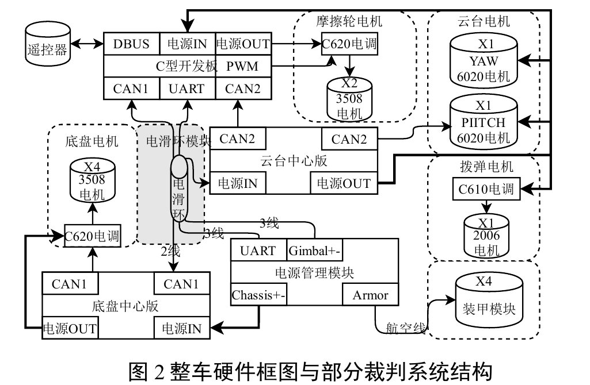
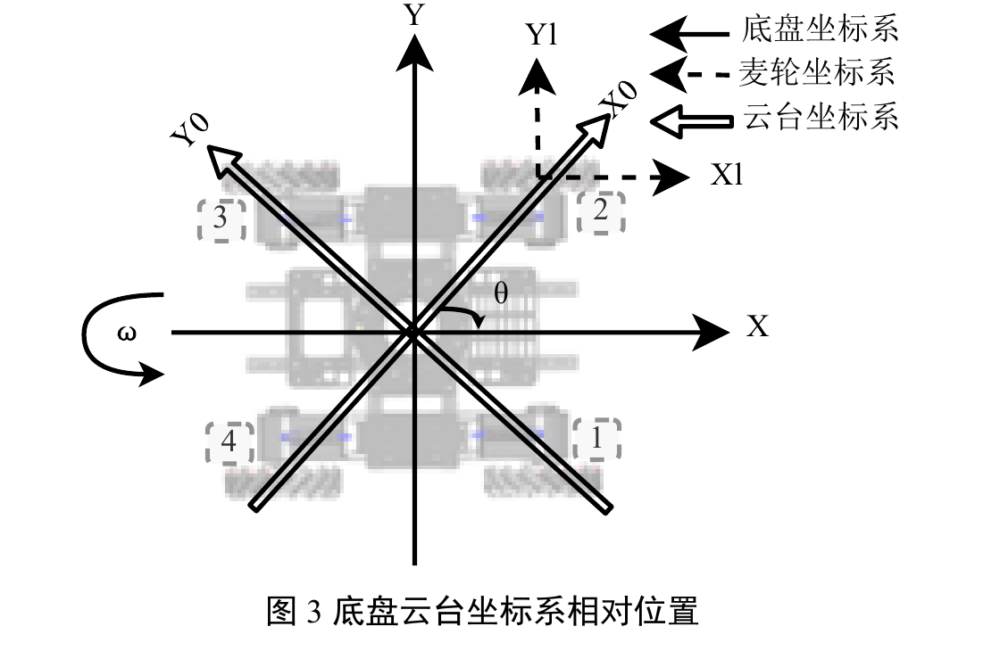
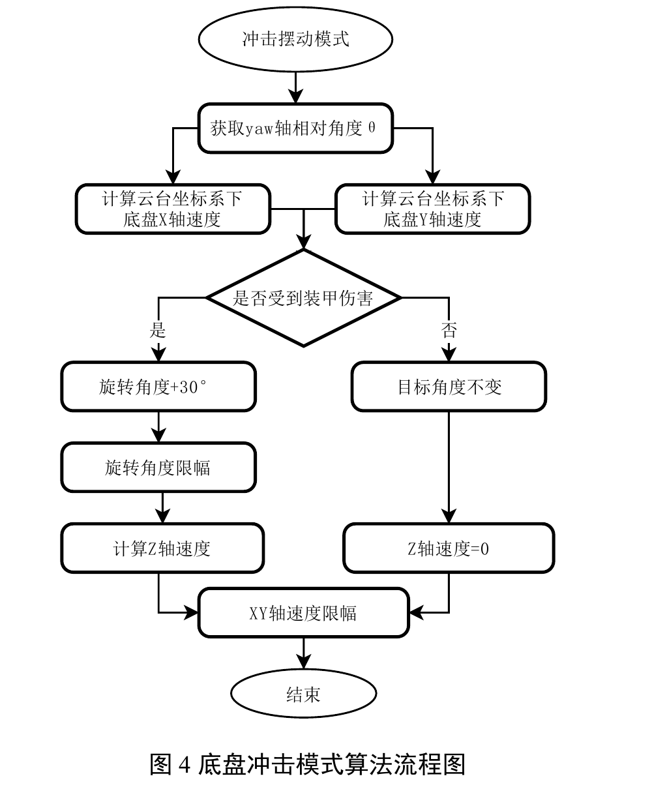
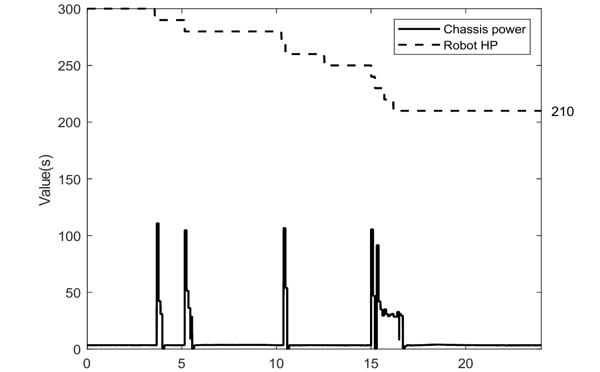
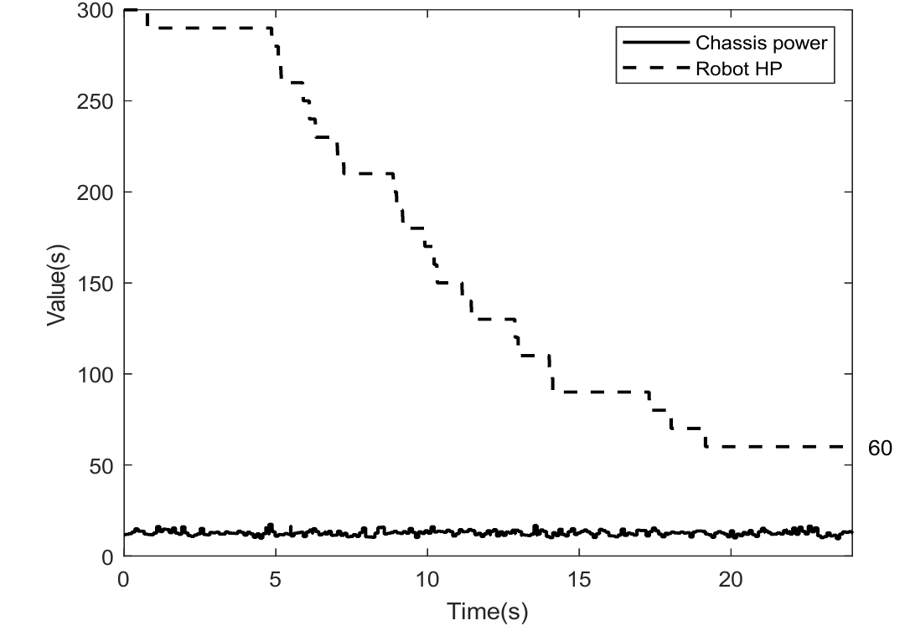
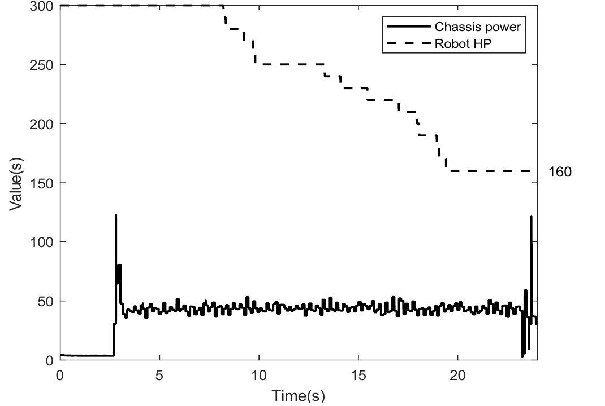

# 步兵小陀螺防御策略优化

本项目面向 RoboMaster 步兵机器人底盘控制，围绕两种相互独立的运动模式展开：

- **小陀螺模式**：底盘持续旋转，云台通过独立控制保持稳定指向，用于机动、观察和持续防御。
- **冲击摆动模式**：检测到装甲受击后，底盘短时旋转约 30°，主动切换受击面，同时保持云台朝向并维持底盘平移能力。

整体控制架构以姿态解算为基础，使底盘运动与云台指向相互解耦。麦克纳姆轮实现全向运动与弹丸规避，导电滑环负责底盘和云台之间的电源与信号传输，云台负责保持稳定视野与目标方向。

## 1. 系统架构

<table>
  <tr>
    <td align="center" width="50%">
      <br>
      <sub>整车硬件框图与部分裁判系统结构</sub>
    </td>
    <td align="center" width="50%">
      <br>
      <sub>底盘云台坐标系相对位置</sub>
    </td>
  </tr>
</table>

系统由五层组成：

- **硬件层**：四轮麦克纳姆底盘、Yaw/Pitch 云台、导电滑环及装甲和射击机构。
- **配置层**：通过 `standard_robot.ioc` 配置 STM32F407 的 CAN、UART、SPI/I2C、定时器、DMA、USB 和 FreeRTOS。
- **驱动层**：STM32 HAL、CMSIS、BSP，以及 BMI088、IST8310 等传感器驱动。
- **控制层**：PID、AHRS、麦轮运动学、CAN 电机通信和功率控制。
- **任务层**：底盘、云台、IMU、裁判系统、射击和故障检测任务。

底盘坐标系以前进方向为 X 轴、左移方向为 Y 轴，云台与底盘的相对角记为 `theta`。控制闭环为：

```text
遥控器/裁判系统 + IMU/编码器
        -> 坐标变换与模式判断
        -> 麦轮运动学与 PID/CAN
        -> 电机执行与姿态反馈
```

云台坐标系到车体坐标系的速度变换为：

```text
X = X0 * cos(theta) - Y0 * sin(theta)
Y = X0 * sin(theta) + Y0 * cos(theta)
```

麦轮速度根据平移速度和角速度解算：

```text
V1 = -Vx - Vy + a * omega    V2 =  Vx - Vy + a * omega
V3 =  Vx + Vy + a * omega    V4 = -Vx + Vy + a * omega
```

其中 `a` 用于修正云台安装位置偏离底盘几何中心带来的影响。

## 2. 小陀螺模式

小陀螺模式通过底盘持续输出角速度 `omega`，并由云台独立的 Yaw/Pitch 闭环保持目标指向。因此，机器人可以原地或边移动边持续自转，而云台仍能保持稳定朝向。

测试采用了 `3 rad/s` 和 `7 rad/s` 两种自转速度。该模式响应直接、连续性好，但机器人整体位置变化有限，装甲可能周期性暴露在相同攻击方向；长时间运行会带来更高功耗和重复受击风险。

<strong>演示视频：</strong>底盘持续旋转时，云台通过独立控制保持稳定朝向。

<video src="https://cdn.jsdelivr.net/gh/WestaRlyh/Infantry_Gyroscope@7215fec/paper_data/Gyroscope.mp4" controls muted playsinline preload="metadata" width="100%"></video>

## 3. 防御策略优化：冲击摆动

<div align="center">
  
</div>

冲击摆动由装甲受击事件触发，不进行持续高速旋转。系统检测裁判系统伤害数据后，将底盘目标角短时增加约 `30°`，经角度限幅和 Z 轴 PID 控制后完成姿态调整；未受击时保持目标角不变，即 `omega = 0`。同时，X/Y 平移速度经过限幅并参与麦轮解算，保证防御动作不会完全打断移动。

该策略通过主动换面改变攻击方向与装甲之间的重复几何关系，减少同一位置连续受击，并结合坐标变换和云台独立控制保留移动、观察和反击能力。

<strong>演示视频：</strong>底盘受到冲击后短时摆动，同时保持云台相对朝向。

<video src="https://cdn.jsdelivr.net/gh/WestaRlyh/Infantry_Gyroscope@7215fec/paper_data/Impact%20Swing.mp4" controls muted playsinline preload="metadata" width="100%"></video>

## 4. 论文测试结论

测试结果表明，冲击摆动在相近条件下的掉血量和受击次数最低，更适合受击后的快速换面；小陀螺则更适合连续机动和主动防御。

<div align="center">
  
</div>

冲击摆动模式下，机器人血量由 300 降至 210，受到小弹丸攻击 9 次；受击时底盘功率出现约 100 W 峰值，随后快速回落。

<table>
  <tr>
    <td align="center" width="50%">
      <strong>小陀螺低速模式（3 rad/s）</strong><br>
      <br>
      <sub>功率稳定在约 20 W，血量由 300 降至 60，受到小弹丸攻击 24 次。</sub>
    </td>
    <td align="center" width="50%">
      <strong>小陀螺高速模式（7 rad/s）</strong><br>
      <br>
      <sub>功率约为 50–60 W，血量由 300 降至 160，受到小弹丸攻击 14 次；启停瞬间存在较大电流冲击。</sub>
    </td>
  </tr>
</table>

## 5. 整体工程内容

这是一个由 CubeMX 配置、STM32 底层代码、FreeRTOS 任务和机器人控制算法组成的完整固件工程：

```text
standard_robot.ioc -> Src/Inc + Drivers/Middlewares -> bsp/components -> application -> MDK-ARM
```

| 目录/文件 | 作用 |
| --- | --- |
| `standard_robot.ioc` | STM32CubeMX 引脚、时钟、通信接口、定时器、DMA 和 FreeRTOS 配置。 |
| `Src/`、`Inc/` | HAL 外设初始化、系统时钟、中断和启动代码。 |
| `Drivers/`、`Middlewares/` | STM32F4 HAL/CMSIS、FreeRTOS 和 USB CDC。 |
| `bsp/`、`components/` | 板级接口、传感器驱动、PID、AHRS 和通用数据结构。 |
| `application/` | 底盘、云台、IMU、裁判系统、射击和故障检测任务。 |
| `MDK-ARM/standard_robot.uvprojx` | Keil MDK-ARM V5 编译、下载和调试工程。 |

关键任务包括：`INS_task` 负责 IMU 与姿态解算，`gimbal_task` 负责云台闭环，`chassis_task` 负责麦轮运动、底盘 PID 和防御模式，`referee_usart_task` 负责裁判系统通信，`detect_task` 负责状态与故障检测。

**编译流程：**

1. 使用 STM32CubeMX 打开 `standard_robot.ioc` 并生成底层代码。
2. 使用 Keil 打开 `MDK-ARM/standard_robot.uvprojx`。
3. 编译、下载并在线调试机器人固件。

当前工程目标为 STM32F407、168 MHz，使用双 CAN、FreeRTOS 和 MDK-ARM V5。修改 `.ioc` 后，应同步检查 Keil 工程的源文件列表，并确认 `theta` 的零点、正方向、角度单位以及麦轮编号与电调 ID。
